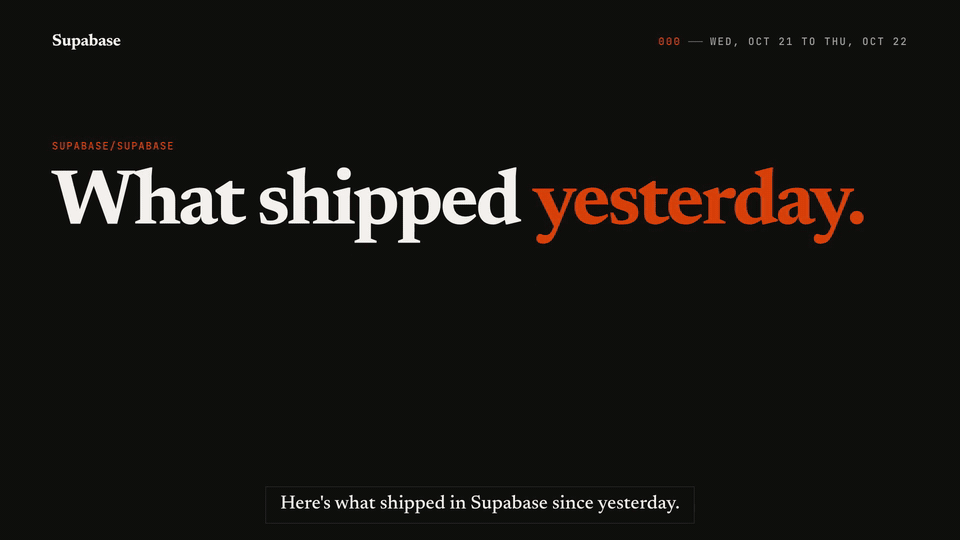

# what-shipped

A Claude Code plugin that turns the last day of merged pull requests into a 90 to 120
second narrated video, for the people on your team who never open a PR.

[](docs/what-shipped-demo.mp4)

**[Watch it with sound (1:34, MP4)](docs/what-shipped-demo.mp4).** Made by this plugin from the
36 PRs merged into `supabase/supabase` between Oct 21 and Oct 22, 2026, using only public
pages. Every spoken claim was checked against its PR and the live site; the checks are in
[docs/demo/VERIFY.md](docs/demo/VERIFY.md). Not affiliated with Supabase.

## Install

In Claude Code:

```
/plugin marketplace add Aielar/what-shipped
/plugin install what-shipped@what-shipped
```

You also need Node 22 or newer, ffmpeg, Google Chrome, Python 3.10 or newer, and the GitHub CLI
signed in (`gh auth status`). The voice (Kokoro), the word timing (Whisper) and the render
(HyperFrames) all run on your machine. The first video installs HyperFrames, GSAP and
Playwright into a `what-shipped/` folder, sets up Kokoro in `~/.cache/what-shipped`, and
downloads the voice and Whisper models, under a gigabyte together. That happens once.

## Your first video

Open Claude Code in a clone of the repo you want to cover and ask for it:

```
/what-shipped
```

(`/what-shipped:what-shipped` if another command already has that name), or in plain words,
"make a what-shipped video for yesterday". Not in a clone? Name the repo: "what shipped in
vercel/next.js today".

That's your part. Claude's part takes 10 to 20 minutes, depending on how busy the day was:

1. `what-shipped/config.json` is written from GitHub: repo, default branch, homepage, and how
   a merge becomes live. Claude goes through it with you once; later videos reuse it.
2. Every PR merged in the last 24 hours is listed with its status: **live**, **next release**,
   or **merged** when the repo has no release signal.
3. A digest groups the day into 3 to 5 themes a customer would notice. Tests, CI, refactors
   and dependency bumps stay out of the narration.
4. Claude writes the script, the voice reads it, and Whisper times every word so each
   animation lands on the word it belongs to.
5. If a change shows on a page, the capture script screenshots it, read-only.
6. You get `what-shipped/<date>/renders/what-shipped.mp4` and a `VERIFY.md` that lists every
   spoken claim next to its PR.

## What's in the video

- **The day at a glance.** Every merge sits on a 24 hour rail at the time it landed, sized by
  its diff. The ones the video covers are lit.
- **One scene per theme.** A real screen with the camera moving to what changed, or a short
  ledger of rows, one per spoken line.
- **Receipts.** Every claim on screen carries its PR number. Status is told by fill, not
  color: solid is live, dashed is not live yet, outline is merged.
- **Captions** for watching on mute, timed by the words and split at natural pauses.
- **A close** with what isn't live yet, who shipped it, and where to ask.

The default look, Ledger, is paper and ink with one accent: a serif for sentences, a mono for
the record. Square corners, hairlines, no gradients. Your name, logo, colors and fonts go in
the config.

## Make it yours

One file holds everything about your product. The plugin itself knows nothing about it.

```json
{
  "repo": "larkwork/larkwork",
  "release": { "mode": "commit", "match": "^release v\\d+\\.\\d+\\.\\d+( \\(#\\d+\\))?$", "author": "larkwork-release[bot]" },
  "capture": {
    "baseUrl": "https://app.larkwork.example",
    "lock": { "selector": "[data-workspace-switcher]", "text": "Larkwork Demo Clinic" },
    "pages": [{ "id": "hours", "url": "/reports/hours", "waitFor": "Hours by team" }]
  },
  "brand": { "name": "Larkwork", "colors": { "accent": "#C2410C" }, "fonts": { "display": "Newsreader", "mono": "JetBrains Mono" } },
  "voice": { "pronounce": { "Larkwork": "Lark work" } },
  "outro": "Questions? Ask in #product-updates."
}
```

Release detection has four modes: a published GitHub release that contains the merge, a
release commit after it (release-please, semantic-release), merge means deployed, or none.
New configs start at none, so nothing is called live until you pick the rule that matches
how your product actually ships.
Every key is explained in
[`references/config.md`](plugins/what-shipped/skills/what-shipped/references/config.md), and
[`examples/larkwork`](plugins/what-shipped/examples/larkwork) is a complete video for a
made-up product, including a custom before-and-after scene.

## Screenshots without side effects

Capturing a live product is where a tool like this could do damage: some pages create
something just by loading. `capture.mjs` is built to fail closed.

- Addresses that commonly write on load (`/new`, `/delete`, `/logout`, `/oauth`, `/invite`,
  `?template=`, and more, read after URL decoding, `#/` routes included) are refused before
  the browser opens them, and so are redirects, script navigations, client-side route
  changes, frames and popups that point at them.
- Requests that could write (anything but GET, HEAD and OPTIONS) never leave the browser,
  unless you list a URL the page needs just to load.
- Links are followed by reading their address, never clicked. The only other actions are tab
  clicks, hover and scroll. No typing.
- A **workspace lock** names the element that proves the browser is in the right place,
  such as your test workspace's switcher. It is checked after load, after the steps, and
  after the shot; the PNG is saved only if all three pass. No lock, no capture.

The safety tests run a local fake app that counts every request: the write-on-load page is
never requested, a POST fired on load never arrives, the trap link's click handler never
fires, nothing is saved from the wrong workspace. `npm test` runs them.

## How it works

The plugin is one skill plus five small scripts the skill drives:

| Script | Does |
| --- | --- |
| `scaffold.mjs` | Writes `config.json` on first run, installs dependencies once, makes the video folder |
| `prs.mjs` | Merged PRs in the window, internal or not, live or not, into `prs.json` |
| `voice.mjs` | Kokoro narration per line, word timings from Whisper, a generated music bed |
| `capture.mjs` | Read-only, workspace-locked screenshots |
| `assemble.mjs` | Fills the scene templates from the voice timing and writes the HyperFrames composition |

Scenes are plain HTML with GSAP timelines, so a custom scene is a copy of a template. Sound
effects and music are generated with ffmpeg; no fonts, logos or libraries are vendored.

## Limits

- GitHub only, through `gh`. Narration is English, in Kokoro's voices.
- A monorepo where parts deploy on different schedules needs `"release": { "mode": "none" }`
  and a check of each page before the voice says "live". The skill does that check, but it is
  only as good as what can be opened.
- Screens behind sign-in need a test workspace and a one-time `node capture.mjs login`.
- Claude writes the script from PR titles, bodies and diffs. Watch it before you send it.

## Development

```
npm install
npm test            # capture safety tests and the example build
npm run gate        # everything a release needs, see tools/gate.sh
```

The gate also scans files and history for a private word list kept outside the repo
(`BANNED_WORDS` in CI). Without the list it fails rather than passes.

## License

MIT, copyright 2026 Aielar.
